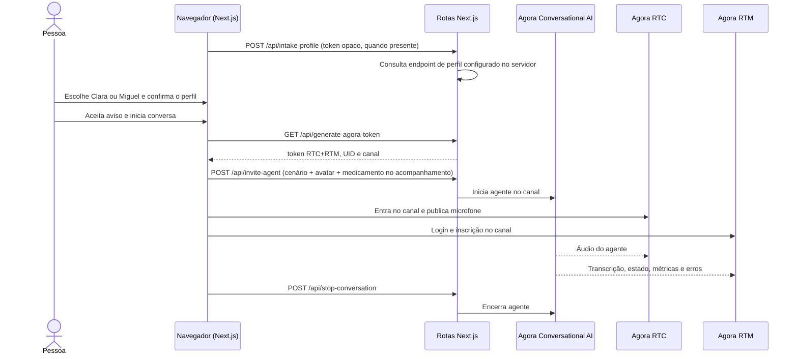

# Integração da Agora na Ouvira

## Visão geral

A Ouvira usa Next.js para controlar a interface e a Agora para transportar a sessão de voz. O servidor emite credenciais temporárias e inicia/encerra o agente Conversational AI. RTM transporta transcrições, estado do agente, métricas e erros para a interface.

## Como funciona no código

1. **Token e canal — `app/api/generate-agora-token/route.ts`.** A rota cria um nome de canal e um UID para a pessoa e gera um token combinado RTC+RTM com validade de uma hora. A chave do App Certificate é usada somente no servidor.
2. **Perfil de convite — `app/api/intake-profile/route.ts`.** Sem token, a página usa um perfil pré-carregado. Quando a URL contém `intake_token`, a interface remove o token da barra de endereço e o envia no corpo da requisição. O servidor consulta `NEXT_WHATSAPP_PROFILE_API_URL` com a chave `NEXT_WHATSAPP_PROFILE_API_KEY` e devolve os campos permitidos sem cache.
3. **Agente — `app/api/invite-agent/route.ts`.** O servidor usa `AgoraClient` e `Agent` do pacote `agora-agents` na região US. O agente compartilha o canal da pessoa, usa o UID definido em `lib/agora.ts` e recebe o UID da pessoa em `remoteUids`. O roteiro em `lib/interview-prompt.ts` conduz cada cenário; no acompanhamento, a rota também recebe somente o nome do medicamento confirmado. CPF, RG e os demais dados do perfil não são enviados ao agente.
4. **Áudio, vídeo e eventos — `components/LandingPage.tsx` e `components/ConversationComponent.tsx`.** A interface inicia a rota do agente e a conexão RTM. O cliente RTC entra no canal, publica o microfone e assina o stream de avatar remoto quando configurado. O Agent Toolkit lê eventos RTM para mostrar transcrição, estado, métricas e erros.
5. **Encerramento — `app/api/stop-conversation/route.ts`.** A interface envia o identificador do agente e o servidor solicita seu encerramento.

## Pipeline e entrevista

O pipeline usa Deepgram Nova-3 com ASR em `pt-BR`, OpenAI `gpt-4o-mini` e MiniMax `speech_2_6_turbo` para TTS. Miguel usa a voz masculina `Portuguese_CalmLeader`; Clara usa `Portuguese_SereneWoman`. Os dois são a mesma assistente de coleta, com roteiro equivalente. As vozes são configuradas por `voiceId` no pacote `agora-agents`; nomes dos perfis de voz podem mudar com a versão do serviço.

A rota `/api/invite-agent` recebe o cenário (`follow-up` ou `report-reaction`) e o avatar (`miguel` ou `clara`), além dos identificadores técnicos da sessão. No acompanhamento, também recebe o rótulo do medicamento confirmado para usar na saudação e nas perguntas. Os demais dados do perfil permanecem no navegador. Em suspeitas, coleta fatos relacionados às perguntas de Naranjo, mas não calcula pontuação nem causalidade. Em situações que indiquem risco imediato, interrompe a entrevista e orienta a busca de atendimento urgente.

Os retratos de Clara e Miguel identificam a escolha de voz. Durante a chamada, o vídeo é exibido somente quando um provider compatível publica um stream Agora real. A aplicação suporta configuração por identidade; credenciais e identificadores ficam no servidor. Sem configuração ou stream conectado, a interface informa que o vídeo está indisponível e mantém a conversa por voz.

## Rascunho e dados

O navegador mantém o perfil, a transcrição e o formulário editável de revisão farmacêutica apenas em memória durante a sessão. Campos sem informação aparecem como pendentes. Nenhum dado é gravado em banco e não há submissão para VigiMed ou VigiFlow. A gravação de áudio/transcrição passa pela infraestrutura Agora para operar a conversa; a tela exige confirmação explícita do perfil e aceite do aviso antes de iniciar.

## Configuração e segurança

- `NEXT_PUBLIC_AGORA_APP_ID`: App ID; usado pelo servidor e pelo cliente.
- `NEXT_AGORA_APP_CERTIFICATE`: App Certificate; somente no servidor.
- `NEXT_WHATSAPP_PROFILE_API_URL` e `NEXT_WHATSAPP_PROFILE_API_KEY`: endpoint HTTPS e credencial de servidor para resolver o token opaco da URL. O endpoint deve invalidar o token após uso. CPF/RG não devem ser incluídos na URL.
- Os valores ficam em `.env.local`, ignorado pelo Git. Não coloque chaves ou valores secretos nesta documentação.
- `.agora/project.json` guarda metadados de vínculo do quickstart; o Agora CLI foi usado para vincular o projeto e gerar o arquivo de ambiente.
- `.agents/skills/agora/SKILL.md` ensina o assistente de código a consultar o quickstart e as referências locais. A skill não faz parte do runtime do produto.

## Referências do repositório

- [Quickstart e arquitetura](../README.md)
- [Código de criação do agente](../app/api/invite-agent/route.ts)
- [Skill local da Agora](../.agents/skills/agora/SKILL.md)
- [Quickstart oficial](https://github.com/AgoraIO-Conversational-AI/agent-quickstart-nextjs)
