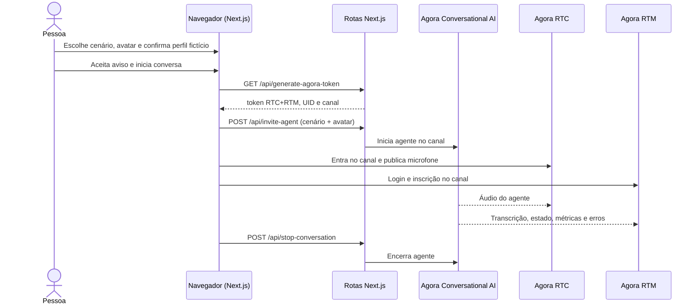

# Integração da Agora no MVP

## Visão geral

O projeto parte do quickstart oficial Next.js da Agora. O navegador cuida da chamada de áudio em tempo real por RTC; o servidor Next.js emite credenciais temporárias e inicia/encerra o agente Conversational AI. RTM transporta transcrições, estado do agente, métricas e erros para a interface.

## Como funciona no código

1. **Token e canal — `app/api/generate-agora-token/route.ts`.** A rota cria um nome de canal e um UID para a pessoa e gera um token combinado RTC+RTM com validade de uma hora. A chave do App Certificate é usada somente no servidor.
2. **Agente — `app/api/invite-agent/route.ts`.** O servidor usa `AgoraClient` e `Agent` do pacote `agora-agents` na região US. O agente compartilha o canal da pessoa, usa o UID definido em `lib/agora.ts` e recebe o UID da pessoa em `remoteUids`.
3. **Áudio e eventos — `components/LandingPage.tsx` e `components/ConversationComponent.tsx`.** A interface inicia a rota do agente e a conexão RTM. O cliente RTC entra no canal e publica o microfone. O Agent Toolkit lê eventos RTM para mostrar transcrição, estado, métricas e erros.
4. **Encerramento — `app/api/stop-conversation/route.ts`.** A interface envia o identificador do agente e o servidor solicita seu encerramento.

## Pipeline e entrevista

O pipeline usa Deepgram Nova-3 com ASR em `pt-BR`, OpenAI `gpt-4o-mini` e MiniMax `speech_2_6_turbo` para TTS. Miguel usa a voz masculina `Portuguese_CalmLeader`; Clara usa `Portuguese_SereneWoman`. Os dois são a mesma assistente de coleta, com roteiro equivalente. As vozes são configuradas por `voiceId` no pacote `agora-agents`; nomes dos perfis de voz podem mudar com a versão do serviço.

A rota `/api/invite-agent` recebe somente o cenário (`follow-up` ou `report-reaction`) e o avatar (`miguel` ou `clara`), além dos identificadores técnicos da sessão. O perfil digitado na tela não é enviado ao servidor. O agente confirma por voz se o relato é sobre quem fala ou um terceiro e segue o roteiro do cenário. Em suspeitas, coleta fatos relacionados às perguntas de Naranjo, mas não calcula pontuação nem causalidade. Em situações que indiquem risco imediato, interrompe a entrevista e orienta a busca de atendimento urgente.

Miguel e Clara são placeholders visuais com iniciais; não há fornecedor de vídeo/avatar conectado. Um avatar de vídeo real exigirá credenciais, identificador do avatar e a configuração de vídeo compatível do fornecedor.

## Rascunho e dados

O navegador mantém o perfil fictício, a transcrição e o formulário editável de revisão farmacêutica apenas em memória durante a sessão. Campos sem informação aparecem como pendentes. Nenhum dado é gravado em banco e não há integração com cadastro real, VigiMed ou VigiFlow. A gravação de áudio/transcrição passa pela infraestrutura Agora para operar a conversa; a tela exige confirmação de ciência antes de iniciar. Use somente dados sintéticos neste MVP.

## Configuração e segurança

- `NEXT_PUBLIC_AGORA_APP_ID`: App ID; usado pelo servidor e pelo cliente.
- `NEXT_AGORA_APP_CERTIFICATE`: App Certificate; somente no servidor.
- Os valores ficam em `.env.local`, ignorado pelo Git. Não coloque chaves ou valores secretos nesta documentação.
- `.agora/project.json` guarda metadados de vínculo do quickstart; o Agora CLI foi usado para vincular o projeto e gerar o arquivo de ambiente.
- `.agents/skills/agora/SKILL.md` ensina o assistente de código a consultar o quickstart e as referências locais. A skill não faz parte do runtime do produto.

## Estado verificado

O diagnóstico do CLI indicou RTC, RTM e Conversational AI habilitados. No localhost, a página respondeu HTTP 200 e as rotas de token e início do agente responderam HTTP 200. Isso confirma o arranque local e a aceitação das chamadas de API; ainda não confirma que o agente entrou no canal nem que áudio bidirecional foi ouvido. A validação final exige iniciar uma conversa no navegador e permitir o uso do microfone.

## Referências do repositório

- [Quickstart e arquitetura](../README.md)
- [Código de criação do agente](../app/api/invite-agent/route.ts)
- [Skill local da Agora](../.agents/skills/agora/SKILL.md)
- [Quickstart oficial](https://github.com/AgoraIO-Conversational-AI/agent-quickstart-nextjs)
